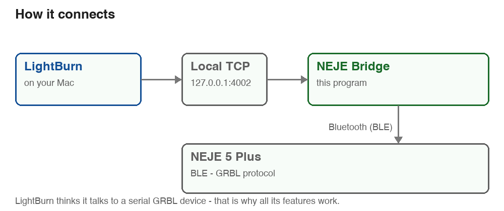
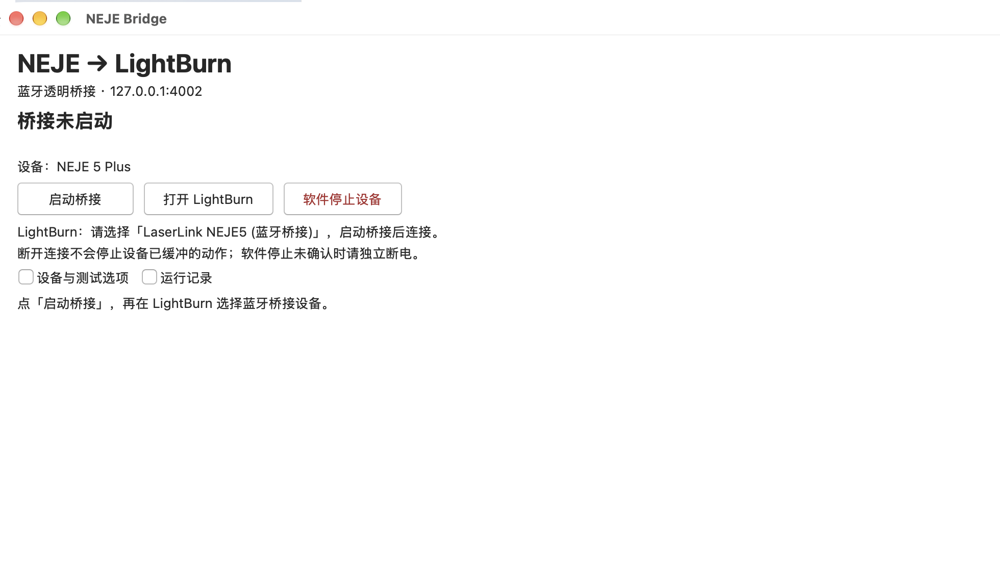

# 用蓝牙在 LightBurn 里使用 NEJE 5 Plus

**语言 / Language:** [简体中文](README.md) · [English](README.en.md)

[](https://github.com/Tingfe/neje-lightburn-bridge/actions/workflows/tests.yml)

不用 USB 线：**NEJE 5 Plus 通过蓝牙连到 LightBurn，功能和 USB 直连基本一样。**



## 下载即用（推荐）

1. **下载** → [macOS 自动构建产物](https://github.com/Tingfe/neje-lightburn-bridge/actions/workflows/macos-build.yml)中的 `NEJE-Bridge-macOS-arm64`（Apple Silicon）；[正式发布页](https://github.com/Tingfe/neje-lightburn-bridge/releases/latest)目前仍是 1.2.4，双语 1.3.0 尚未发布为 Release。Intel 图形包暂未验证
2. 解压，把 **NEJE Bridge.app** 拖进「应用程序」
3. **第一次右键 → 打开**（未做 Apple 公证，双击会被 Gatekeeper 拦；之后即可正常双击）

然后：

1. 打开 **NEJE Bridge**，点 **启动桥接**
   —— 右上角可切换 **中文 / English**，选择会保存，下次启动沿用
2. **LightBurn** 里选设备 `LaserLink NEJE5 (蓝牙桥接)` → 点**连接**
3. 照常用：**Start 加工自己的设计、回零、点动、改设置**

> 不用装 Python、不用敲任何命令。界面每个会话结束会**自动做一次独立审计**并显示结论。

## 能做什么

| | |
| --- | --- |
| ✅ **直接按 Start 加工自己的设计** | 不用先导出 GCode，不用预先审阅 |
| ✅ **回零、点动、改设置、读位置** | 与 USB 直连相同 |
| ✅ **真实出光** | 实测：10% 功率 + **300 mm/min** 痕迹明显 |
| ✅ 会话结束**自动审计** | 界面直接显示结论；篡改会被抓出 |
| ✅ **一键急停不了时**：用 LightBurn 的 Stop + 切断设备电源 | 见「安全」 |

## 兼容性 / 硬件要求

| 项 | 要求 |
| --- | --- |
| 激光机 | **NEJE 5 Plus**（模块 A40640，455nm 蓝光二极管） |
| 电脑 | 当前打包脚本只构建 **Apple Silicon / arm64**；Intel 暂无经过验证的图形安装包 |
| LightBurn | 支持 TCP/Ethernet 设备的版本（实测 2.0.05） |
| 网络端口 | LightBurn 设备的默认端口是 **23**，必须改成 **4002** |

> 其它 NEJE 机型/模块**未验证** —— 协议层可能相同，但请自行判断风险。

## 安全（请先读这一段）

- **只有设备自身的电源开关能真正停下机器。** 软件停止、断开连接、蓝牙掉线**都不可靠**。
- 出光前逐项确认：**护目镜（455nm）· 通风 · 灭火设备在手边 · 能随时切断主电源 · 行程净空 · 手离开机器**。
- **首次出光务必先慢。** 实测对照（同功率 10%）：`300 mm/min` → **痕迹明显**；`6000 mm/min` → **无痕**（9mm 的线只跑 0.09 秒）。
- 更多：[首次出光方案](docs/level-e-test-plan.md)

## 界面



启动后是一个小窗口，不用记命令和地址：

- **状态**：桥接是否在跑、第几个会话
- **按钮**：启动桥接 · 打开 LightBurn · 软件停止设备
- **语言**：右上角选择中文或 English；状态、确认窗口和新产生的运行提示随之切换，历史日志不重写
- **双语版本核验**：[1.3.0 本机包与验证范围](docs/bilingual-gui-20261018.md)
- **设备**：扫描 → 在下拉框选择设备；选择会立即保存
- **审计**：每个会话结束自动显示结论
- 运行记录同时写到 `~/Library/Logs/NEJE/app.log`

## 连不上怎么办

| 现象 | 处理 |
| --- | --- |
| LightBurn 连不上 | 确认桥接**正在运行**（窗口显示"桥接运行中"）；确认设备是 **Ethernet/TCP、127.0.0.1、端口 4002**（LightBurn 的默认端口是 23，必须改） |
| USB 和蓝牙都连不上，或提示 `Your device is not at GRBL mode` | 先停止当前作业、关闭 LightBurn 与桥接，确认设备没有运动；将设备电源和设备端 USB **都断开至少 10 秒**，再先接电源、后接 USB。USB 线可能继续给控制板供电，单关设备电源未必完成重启。重启后先检查模式/连接，再恢复位置基准；不要连续点击 Start 或 Home。见 [2026-10-18 实例](docs/connection-recovery-20261018.md) |
| 改了端口还是不行 | 在 LightBurn 里**右键激光面板的设备按钮 → 重连** |
| 想换一台设备 | 窗口点「扫描设备」，从下拉框选 |
| 每次断开都要重开程序？ | 不用 —— 窗口会**自动**在会话之间准备好新连接（约 1～2 秒） |
| 显示 Ready，但点 Start 没有动作 | 先别连续重试。打开 LightBurn「预览」：若画布空白且为 `0:00`，检查图片是否随工程保存；本机实测可重新导入原图并「另存为 → LightBurn 旧工程 (*.lbrn)」，重开确认预览非零。若预览有路径，再查桥接日志是否收到作业行。见[现场诊断与恢复副本](docs/image-job-no-start-20261015.md) |
| Ready 旁百分比与机器动作不同步 | [LightBurn 官方说明](https://docs.lightburnsoftware.com/1.7/Reference/LaserWindow/)：百分比是已流送**命令**的比例，并非实际机械路径完成比例；要等真实设备 Idle、零功率和现场动作完成，不能只看百分比 |
| 出光/停止异常 | 先用**隔离试跑**排查；停止用 LightBurn 的 Stop + **切断设备电源** |
| 想排查设备模式 | `python3 tools/neje.py --check`（需先停止桥接） |

## 想深入了解

这个仓库的其余部分记录了大量实机实验、故障注入与审计方法，属于**开发者/研究性内容**：

| 文档 | 内容 |
| --- | --- |
| [日常使用指南](docs/daily-use-guide.md) | 完整操作、故障处置、工具索引 |
| [LightBurn 配置](docs/transparent-lightburn-setup.md) | 设备设置逐项说明 |
| [透明桥接方案](docs/transparent-bridge-plan.md) | 设计取舍与安全边界 |
| [项目进度](docs/overall-progress.md) | 验收矩阵与剩余项 |

## 许可

[MIT](LICENSE)。软件按「现状」提供；激光可致盲、可引燃，使用者自行承担全部风险（见 [免责声明](DISCLAIMER.md)）。

## 从源码运行（开发者）

```sh
pip3 install bleak
python3 tools/neje.py          # 完整功能
python3 tools/neje.py --test   # 激光隔离的安全试跑
python3 tools/neje.py --check  # 检查设备是否在 GRBL 模式
```

macOS 上也可双击 `neje.command`。自行打包：`sh packaging/build-macos.sh python dist/macos-app`
（依赖锁定在 `packaging/requirements-macos.txt`）。

## 参与贡献

欢迎提交 issue 与 PR —— 请先读 [贡献指南](CONTRIBUTING.md)，其中写明了本项目的**证据分级**与**失败记录**约定。
